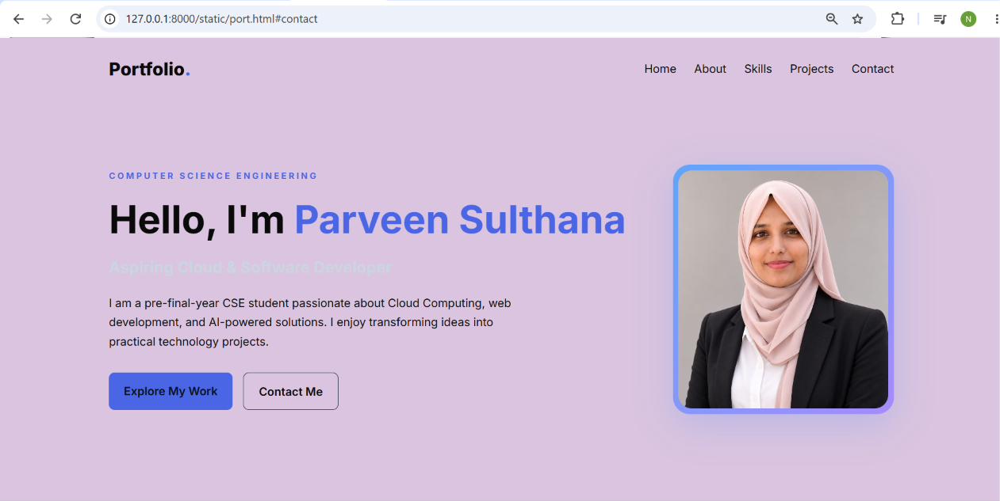
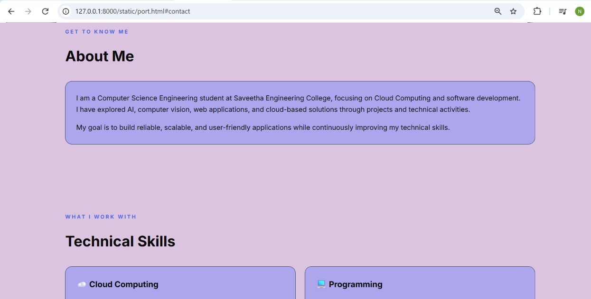
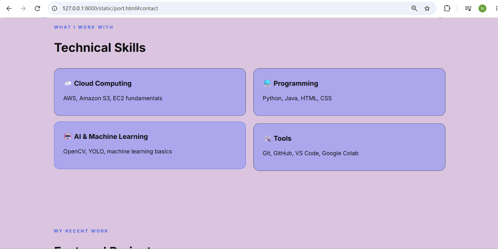
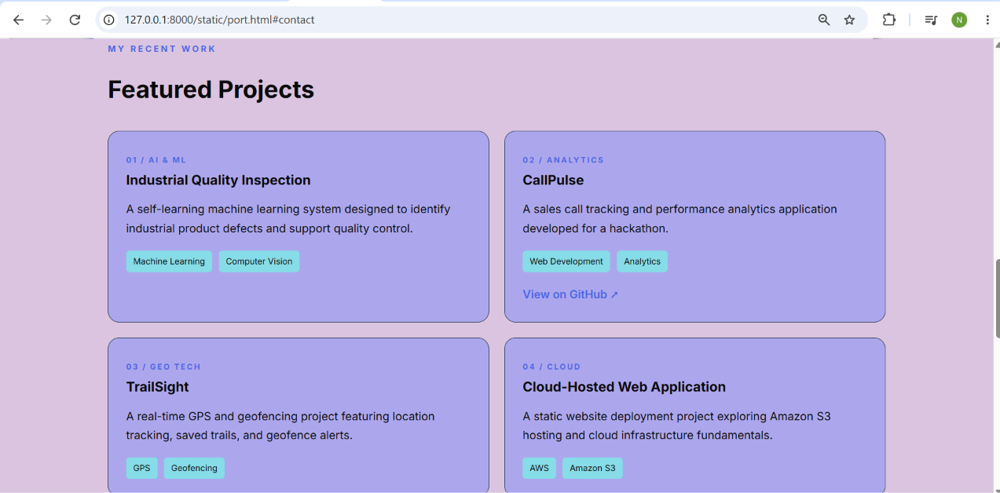
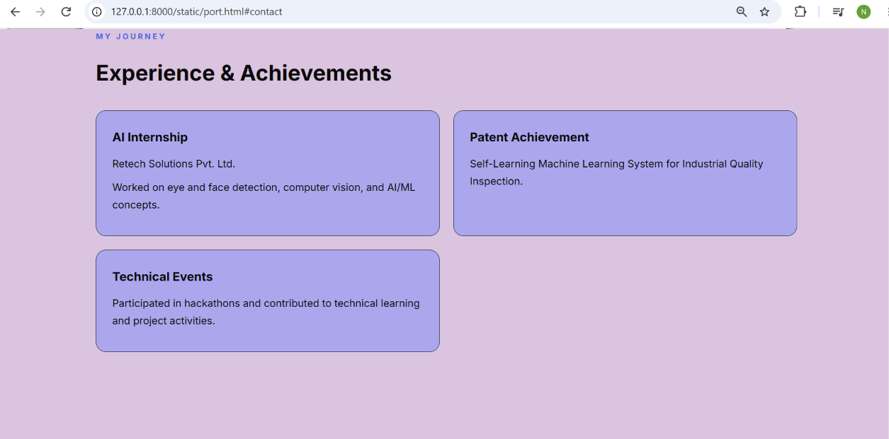
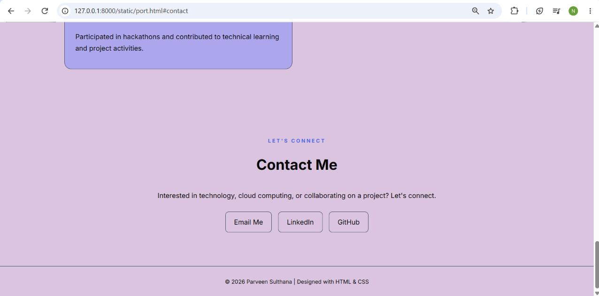

# Ex01 Portfolio
## Date:24/10/2026

## AIM
To create a Portfolio using HTML and CSS.

## ALGORITHM
### STEP 1
Create an HTML file (index.html)

### STEP 2
Create a CSS file (style.css)

### STEP 3
Include a navigation bar with links to different sections.

### STEP 4
Add structured sections for introduction, about, projects, and contact details.

### STEP 5
Define global styles for fonts, colors, and layout.

### STEP 6
Style the header, navigation bar, and sections.

### STEP 7
Use Flexbox or CSS Grid for layout design.

### STEP 8
Add hover effects and transitions for interactivity.

### STEP 9
Add Images and Media.

### STEP 10
Use optimized images for a professional look.

### STEP 11
Open the HTML file in a browser to check layout and functionality.

### STEP 12
Fix styling issues and refine content placement.

### STEP 13
Deploy the Portfolio.

### STEP 14
Upload to GitHub Pages for free hosting.

## PROGRAM
```
port.html


<!DOCTYPE html>
<html lang="en">
<head>
    <meta charset="UTF-8">
    <meta name="viewport" content="width=device-width, initial-scale=1.0">
    <title>My Portfolio | Cloud Computing</title>
    <link rel="stylesheet" href="port.css">
</head>
<body>

    <header>
        <nav class="navbar">
            <a href="#home" class="logo">Portfolio<span>.</span></a>
            <ul class="nav-links">
                <li><a href="#home">Home</a></li>
                <li><a href="#about">About</a></li>
                <li><a href="#skills">Skills</a></li>
                <li><a href="#projects">Projects</a></li>
                <li><a href="#contact">Contact</a></li>
            </ul>
        </nav>
    </header>

    <section class="hero" id="home">
        <div class="hero-content">
            <p class="tag">COMPUTER SCIENCE ENGINEERING</p>
            <h1>Hello, I'm <span>Parveen Sulthana</span></h1>
            <h2>Aspiring Cloud & Software Developer</h2>
            <p class="intro">
                I am a pre-final-year CSE student passionate about
                Cloud Computing, web development, and AI-powered
                solutions. I enjoy transforming ideas into practical
                technology projects.
            </p>
            <div class="buttons">
                <a href="#projects" class="btn primary">Explore My Work</a>
                <a href="#contact" class="btn secondary">Contact Me</a>
            </div>
        </div>

        <div class="profile-container">
            <!-- PUT YOUR IMAGE HERE -->
            
        </div>
    </section>

    <section class="section" id="about">
        <p class="tag">GET TO KNOW ME</p>
        <h2 class="section-title">About Me</h2>
        <div class="about-card">
            <p>
                I am a Computer Science Engineering student at
                Saveetha Engineering College, focusing on Cloud
                Computing and software development. I have explored
                AI, computer vision, web applications, and
                cloud-based solutions through projects and
                technical activities.
            </p>
            <p>
                My goal is to build reliable, scalable, and
                user-friendly applications while continuously
                improving my technical skills.
            </p>
        </div>
    </section>

    <section class="section" id="skills">
        <p class="tag">WHAT I WORK WITH</p>
        <h2 class="section-title">Technical Skills</h2>

        <div class="card-grid">
            <div class="card">
                <h3>☁️ Cloud Computing</h3>
                <p>AWS, Amazon S3, EC2 fundamentals</p>
            </div>
            <div class="card">
                <h3>💻 Programming</h3>
                <p>Python, Java, HTML, CSS</p>
            </div>
            <div class="card">
                <h3>🤖 AI & Machine Learning</h3>
                <p>OpenCV, YOLO, machine learning basics</p>
            </div>
            <div class="card">
                <h3>🛠️ Tools</h3>
                <p>Git, GitHub, VS Code, Google Colab</p>
            </div>
        </div>
    </section>

    <section class="section" id="projects">
        <p class="tag">MY RECENT WORK</p>
        <h2 class="section-title">Featured Projects</h2>

        <div class="card-grid">
            <div class="card project-card">
                <span class="project-number">01 / AI & ML</span>
                <h3>Industrial Quality Inspection</h3>
                <p>
                    A self-learning machine learning system
                    designed to identify industrial product
                    defects and support quality control.
                </p>
                <span class="chip">Machine Learning</span>
                <span class="chip">Computer Vision</span>
            </div>

            <div class="card project-card">
                <span class="project-number">02 / ANALYTICS</span>
                <h3>CallPulse</h3>
                <p>
                    A sales call tracking and performance
                    analytics application developed for a
                    hackathon.
                </p>
                <span class="chip">Web Development</span>
                <span class="chip">Analytics</span>
                <a href="https://github.com/Parveensulthanaj/CallPulse-hack"
                   target="_blank" rel="noopener noreferrer">
                   View on GitHub ↗
                </a>
            </div>

            <div class="card project-card">
                <span class="project-number">03 / GEO TECH</span>
                <h3>TrailSight</h3>
                <p>
                    A real-time GPS and geofencing project
                    featuring location tracking, saved trails,
                    and geofence alerts.
                </p>
                <span class="chip">GPS</span>
                <span class="chip">Geofencing</span>
            </div>

            <div class="card project-card">
                <span class="project-number">04 / CLOUD</span>
                <h3>Cloud-Hosted Web Application</h3>
                <p>
                    A static website deployment project
                    exploring Amazon S3 hosting and
                    cloud infrastructure fundamentals.
                </p>
                <span class="chip">AWS</span>
                <span class="chip">Amazon S3</span>
            </div>
        </div>
    </section>

    <section class="section" id="experience">
        <p class="tag">MY JOURNEY</p>
        <h2 class="section-title">Experience & Achievements</h2>

        <div class="card-grid">
            <div class="card">
                <h3>AI Internship</h3>
                <p>Retech Solutions Pvt. Ltd.</p>
                <p>
                    Worked on eye and face detection,
                    computer vision, and AI/ML concepts.
                </p>
            </div>

            <div class="card">
                <h3>Patent Achievement</h3>
                <p>
                    Self-Learning Machine Learning System
                    for Industrial Quality Inspection.
                </p>
            </div>

            <div class="card">
                <h3>Technical Events</h3>
                <p>
                    Participated in hackathons and contributed
                    to technical learning and project activities.
                </p>
            </div>
        </div>
    </section>

    <section class="section contact" id="contact">
        <p class="tag">LET'S CONNECT</p>
        <h2 class="section-title">Contact Me</h2>
        <p>
            Interested in technology, cloud computing,
            or collaborating on a project? Let's connect.
        </p>
        <div class="contact-links">
            <!-- Replace these example links with your own -->
            <a href="mailto:noorij750@gmail.com">Email Me</a>
            <a href="https://www.linkedin.com/in/parveen-sulthana-a6469232a/" target="_blank"
               rel="noopener noreferrer">LinkedIn</a>
            <a href="https://github.com/Parveensulthanaj"
               target="_blank" rel="noopener noreferrer">GitHub</a>
        </div>
    </section>

    <footer>
        <p>© 2026 Parveen Sulthana | Designed with HTML & CSS</p>
    </footer>

</body>
</html>

```

```
port.css


/* Google Fonts */
@import url('https://fonts.googleapis.com/css2?family=Inter:wght@400;500;600;700;800&display=swap');

* {
    margin: 0;
    padding: 0;
    box-sizing: border-box;
    scroll-behavior: smooth;
}

:root {
    --bg: #dac4df;
    --card: #aca7ed;
    --text: #0b0a0b;
    --muted: #0c0c0c;
    --accent: #4a66e4;
    --border: #27364d;
}

body {
    font-family: 'Inter', sans-serif;
    background: var(--bg);
    color: var(--text);
    line-height: 1.7;
}

a {
    color: inherit;
    text-decoration: none;
}

.navbar {
    max-width: 1150px;
    margin: auto;
    padding: 22px 25px;
    display: flex;
    justify-content: space-between;
    align-items: center;
}

.logo {
    font-size: 25px;
    font-weight: 800;
}

.logo span,
.hero h1 span {
    color: var(--accent);
}

.nav-links {
    display: flex;
    gap: 25px;
    list-style: none;
}

.nav-links a {
    color: var(--muted);
    transition: 0.3s;
}

.nav-links a:hover {
    color: var(--accent);
}

.hero {
    max-width: 1150px;
    min-height: 82vh;
    margin: auto;
    padding: 70px 25px;
    display: flex;
    align-items: center;
    justify-content: space-between;
    gap: 50px;
}

.hero-content {
    flex: 1;
}

.tag {
    color: var(--accent);
    font-size: 12px;
    font-weight: 700;
    letter-spacing: 3px;
    margin-bottom: 18px;
}

.hero h1 {
    font-size: clamp(34px, 5vw, 54px);
    line-height: 1.2;
    margin-bottom: 16px;
}

.hero h2 {
    font-size: 22px;
    color: #cbd5e1;
    margin-bottom: 18px;
}

.intro {
    color: var(--muted);
    max-width: 580px;
}

.buttons {
    display: flex;
    gap: 15px;
    flex-wrap: wrap;
    margin-top: 30px;
}

.btn {
    padding: 12px 21px;
    border-radius: 8px;
    font-weight: 600;
    transition: 0.3s;
}

.primary {
    background: var(--accent);
    color: #07111f;
}

.secondary {
    border: 1px solid var(--border);
}

.btn:hover {
    transform: translateY(-3px);
}

.profile-container {
    width: 310px;
    height: 350px;
    flex-shrink: 0;
    padding: 8px;
    border-radius: 24px;
    background: linear-gradient(135deg, #60a5fa, #a78bfa);
    box-shadow: 0 15px 50px #3b82f633;
}

.profile-img {
    display: block;
    width: 100%;
    height: 100%;
    object-fit: cover;
    object-position: center;
    border-radius: 19px;
    background: var(--card);
}

.section {
    max-width: 1150px;
    margin: auto;
    padding: 80px 25px;
}

.section-title {
    font-size: 34px;
    margin-bottom: 30px;
}

.about-card,
.card {
    background: var(--card);
    border: 1px solid var(--border);
    border-radius: 16px;
    padding: 25px;
}

.about-card p {
    color: var(--muted);
    margin-bottom: 15px;
}

.about-card p:last-child {
    margin-bottom: 0;
}

.card-grid {
    display: grid;
    grid-template-columns: repeat(2, minmax(0, 1fr));
    gap: 22px;
}

.card {
    transition: transform 0.3s, border-color 0.3s;
}

.card:hover {
    transform: translateY(-5px);
    border-color: var(--accent);
}

.card h3 {
    font-size: 19px;
    margin-bottom: 12px;
}

.card p {
    color: var(--muted);
    margin-bottom: 10px;
}

.project-number {
    color: var(--accent);
    font-size: 11px;
    letter-spacing: 2px;
    font-weight: 700;
}

.chip {
    display: inline-block;
    color: #0e0e0e;
    background: #86dce7;
    padding: 5px 10px;
    margin: 8px 5px 0 0;
    border-radius: 5px;
    font-size: 12px;
}

.project-card > a {
    display: block;
    color: var(--accent);
    margin-top: 18px;
    font-weight: 600;
}

.contact {
    text-align: center;
}

.contact > p:not(.tag) {
    color: var(--muted);
}

.contact-links {
    display: flex;
    justify-content: center;
    flex-wrap: wrap;
    gap: 15px;
    margin-top: 25px;
}

.contact-links a {
    padding: 10px 20px;
    border: 1px solid var(--border);
    border-radius: 8px;
    transition: 0.3s;
}

.contact-links a:hover {
    background: var(--accent);
    color: var(--bg);
}

footer {
    text-align: center;
    padding: 25px;
    border-top: 1px solid var(--border);
    color: var(--muted);
    font-size: 13px;
}

/* Mobile responsive design */
@media (max-width: 768px) {
    .navbar {
        flex-direction: column;
        gap: 15px;
    }

    .nav-links {
        justify-content: center;
        flex-wrap: wrap;
        gap: 12px 18px;
    }

    .hero {
        flex-direction: column-reverse;
        text-align: center;
        padding-top: 40px;
        gap: 35px;
    }

    .profile-container {
        width: 230px;
        height: 270px;
    }

    .buttons {
        justify-content: center;
    }

    .card-grid {
        grid-template-columns: 1fr;
    }

    .section {
        padding: 55px 20px;
    }

    .section-title {
        font-size: 28px;
    }
}
```


## OUTPUT







## RESULT
The program for creating Portfolio using HTML and CSS is executed successfully.
