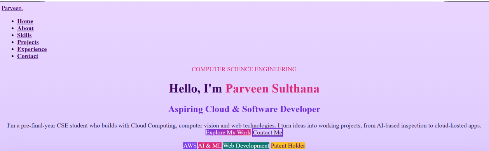
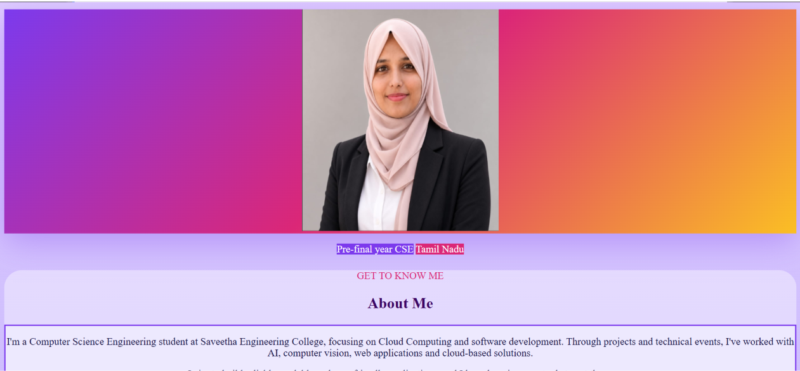
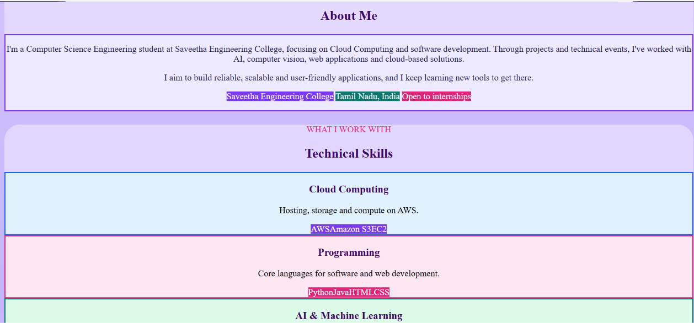
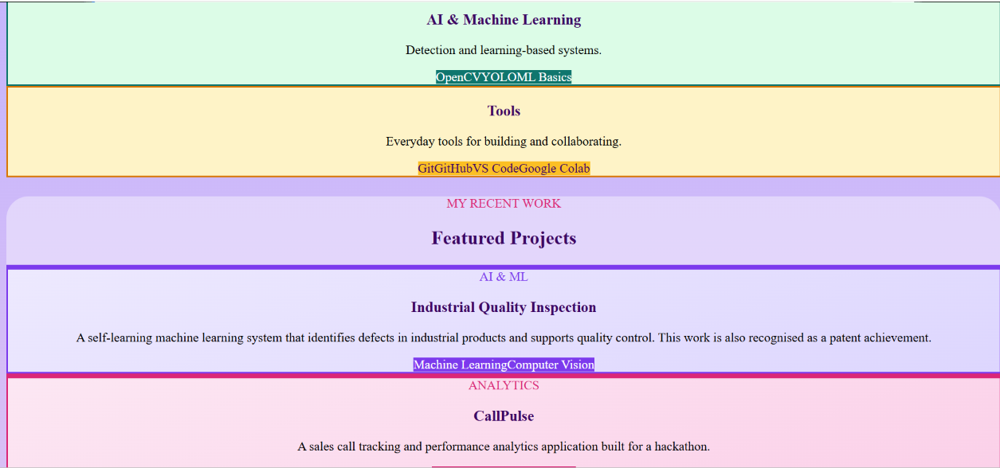
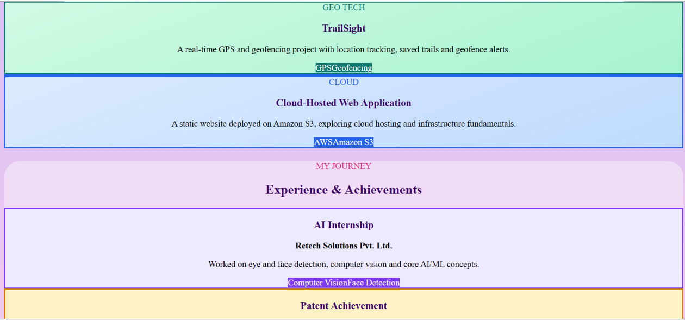
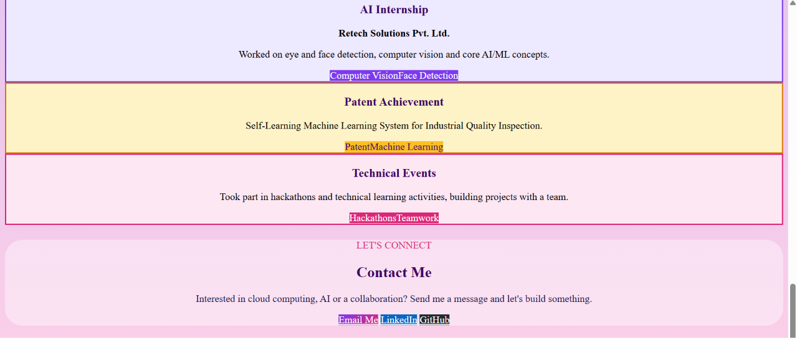

# Ex01 Portfolio
## Date:24/10/2026

## AIM
To create a Portfolio using HTML and CSS.

## ALGORITHM
### STEP 1
Create an HTML file (index.html)

### STEP 2
Create a CSS file (style.css)

### STEP 3
Include a navigation bar with links to different sections.

### STEP 4
Add structured sections for introduction, about, projects, and contact details.

### STEP 5
Define global styles for fonts, colors, and layout.

### STEP 6
Style the header, navigation bar, and sections.

### STEP 7
Use Flexbox or CSS Grid for layout design.

### STEP 8
Add hover effects and transitions for interactivity.

### STEP 9
Add Images and Media.

### STEP 10
Use optimized images for a professional look.

### STEP 11
Open the HTML file in a browser to check layout and functionality.

### STEP 12
Fix styling issues and refine content placement.

### STEP 13
Deploy the Portfolio.

### STEP 14
Upload to GitHub Pages for free hosting.

## PROGRAM
```
port.html

<!DOCTYPE html>
<html lang="en">
<head>
    <meta charset="UTF-8">
    <meta name="viewport" content="width=device-width, initial-scale=1.0">
    <meta name="description" content="Portfolio of Parveen Sulthana, pre-final-year CSE student focused on Cloud Computing, AI and web development.">
    <title>Parveen Sulthana | Cloud &amp; Software Developer</title>
    <link rel="stylesheet" href="port.css">
</head>
<body style="background:linear-gradient(180deg,#e9d5ff 0%,#c4b5fd 45%,#fbcfe8 100%);">

    <header>
        <nav class="navbar" style="justify-content:center;gap:20px 40px;flex-wrap:wrap;">
            <a href="#home" class="logo" style="color:#3b0764;">Parveen<span style="color:#db2777;">.</span></a>
            <ul class="nav-links" style="flex-wrap:wrap;justify-content:center;">
                <li><a href="#home" style="color:#3b0764;font-weight:600;">Home</a></li><li><a href="#about" style="color:#3b0764;font-weight:600;">About</a></li><li><a href="#skills" style="color:#3b0764;font-weight:600;">Skills</a></li><li><a href="#projects" style="color:#3b0764;font-weight:600;">Projects</a></li><li><a href="#experience" style="color:#3b0764;font-weight:600;">Experience</a></li><li><a href="#contact" style="color:#3b0764;font-weight:600;">Contact</a></li>
            </ul>
        </nav>
    </header>

    <main>

        <!-- HERO -->
        <section class="hero" id="home">
            <div class="hero-content" style="text-align:center;">
                <p class="tag" style="color:#db2777;">COMPUTER SCIENCE ENGINEERING</p>
                <h1 style="color:#3b0764;">Hello, I'm <span style="color:#db2777;">Parveen Sulthana</span></h1>
                <h2 style="color:#6d28d9;">Aspiring Cloud &amp; Software Developer</h2>
                <p class="intro" style="margin:0 auto;color:#1e1b4b;">
                    I'm a pre-final-year CSE student who builds with
                    Cloud Computing, computer vision and web technologies.
                    I turn ideas into working projects, from AI-based
                    inspection to cloud-hosted apps.
                </p>
                <div class="buttons" style="justify-content:center;">
                    <a href="#projects" class="btn primary" style="background:linear-gradient(135deg,#7c3aed,#db2777);color:#ffffff;">Explore My Work</a>
                    <a href="#contact" class="btn secondary" style="border:2px solid #6d28d9;color:#3b0764;">Contact Me</a>
                </div>
                <p>
                    <span class="chip" style="background:#7c3aed;color:#fff;">AWS</span>
                    <span class="chip" style="background:#db2777;color:#fff;">AI &amp; ML</span>
                    <span class="chip" style="background:#0f766e;color:#fff;">Web Development</span>
                    <span class="chip" style="background:#fbbf24;color:#3b0764;">Patent Holder</span>
                </p>
            </div>

            <div class="hero-photo" style="text-align:center;">
                <div class="profile-container" style="margin:0 auto 14px;background:linear-gradient(135deg,#7c3aed,#db2777,#fbbf24);box-shadow:0 15px 50px rgba(124,58,237,0.35);">
                    
                </div>
                <p>
                    <span class="chip" style="background:#7c3aed;color:#fff;">Pre-final year CSE</span>
                    <span class="chip" style="background:#db2777;color:#fff;">Tamil Nadu</span>
                </p>
            </div>
        </section>

        <!-- ABOUT -->
        <section class="section" id="about" style="margin:24px auto;background:rgba(255,255,255,0.40);border-radius:28px;text-align:center;">
            <p class="tag" style="color:#db2777;">GET TO KNOW ME</p>
            <h2 class="section-title" style="color:#3b0764;">About Me</h2>
            <div class="about-card" style="background:#ede9fe;border:2px solid #7c3aed;text-align:center;">
                <p style="color:#1e1b4b;">
                    I'm a Computer Science Engineering student at
                    Saveetha Engineering College, focusing on Cloud
                    Computing and software development. Through projects
                    and technical events, I've worked with AI, computer
                    vision, web applications and cloud-based solutions.
                </p>
                <p style="color:#1e1b4b;">
                    I aim to build reliable, scalable and user-friendly
                    applications, and I keep learning new tools to get
                    there.
                </p>
                <p>
                    <span class="chip" style="background:#7c3aed;color:#fff;">Saveetha Engineering College</span>
                    <span class="chip" style="background:#0f766e;color:#fff;">Tamil Nadu, India</span>
                    <span class="chip" style="background:#db2777;color:#fff;">Open to internships</span>
                </p>
            </div>
        </section>

        <!-- SKILLS -->
        <section class="section" id="skills" style="margin:24px auto;background:rgba(255,255,255,0.40);border-radius:28px;text-align:center;">
            <p class="tag" style="color:#db2777;">WHAT I WORK WITH</p>
            <h2 class="section-title" style="color:#3b0764;">Technical Skills</h2>

            <div class="card-grid">
                <div class="card" style="background:#e0f2fe;border:2px solid #2563eb;text-align:center;">
                    <h3 style="color:#3b0764;">Cloud Computing</h3>
                    <p>Hosting, storage and compute on AWS.</p>
                    <div><span class="chip" style="background:#7c3aed;color:#fff;">AWS</span><span class="chip" style="background:#7c3aed;color:#fff;">Amazon S3</span><span class="chip" style="background:#7c3aed;color:#fff;">EC2</span></div>
                </div>
                <div class="card" style="background:#fce7f3;border:2px solid #db2777;text-align:center;">
                    <h3 style="color:#3b0764;">Programming</h3>
                    <p>Core languages for software and web development.</p>
                    <div><span class="chip" style="background:#db2777;color:#fff;">Python</span><span class="chip" style="background:#db2777;color:#fff;">Java</span><span class="chip" style="background:#db2777;color:#fff;">HTML</span><span class="chip" style="background:#db2777;color:#fff;">CSS</span></div>
                </div>
                <div class="card" style="background:#dcfce7;border:2px solid #0f766e;text-align:center;">
                    <h3 style="color:#3b0764;">AI &amp; Machine Learning</h3>
                    <p>Detection and learning-based systems.</p>
                    <div><span class="chip" style="background:#0f766e;color:#fff;">OpenCV</span><span class="chip" style="background:#0f766e;color:#fff;">YOLO</span><span class="chip" style="background:#0f766e;color:#fff;">ML Basics</span></div>
                </div>
                <div class="card" style="background:#fef3c7;border:2px solid #d97706;text-align:center;">
                    <h3 style="color:#3b0764;">Tools</h3>
                    <p>Everyday tools for building and collaborating.</p>
                    <div><span class="chip" style="background:#fbbf24;color:#3b0764;">Git</span><span class="chip" style="background:#fbbf24;color:#3b0764;">GitHub</span><span class="chip" style="background:#fbbf24;color:#3b0764;">VS Code</span><span class="chip" style="background:#fbbf24;color:#3b0764;">Google Colab</span></div>
                </div>
            </div>
        </section>

        <!-- PROJECTS -->
        <section class="section" id="projects" style="margin:24px auto;background:rgba(255,255,255,0.40);border-radius:28px;text-align:center;">
            <p class="tag" style="color:#db2777;">MY RECENT WORK</p>
            <h2 class="section-title" style="color:#3b0764;">Featured Projects</h2>

            <div class="card-grid">
                <article class="card project-card" style="background:linear-gradient(160deg,#ede9fe,#ddd6fe);border:2px solid #7c3aed;border-top:6px solid #7c3aed;text-align:center;">
                    <span class="project-number" style="color:#7c3aed;">AI &amp; ML</span>
                    <h3 style="color:#3b0764;">Industrial Quality Inspection</h3>
                    <p>A self-learning machine learning system that identifies defects in industrial products and supports quality control. This work is also recognised as a patent achievement.</p>
                    <div><span class="chip" style="background:#7c3aed;color:#fff;">Machine Learning</span><span class="chip" style="background:#7c3aed;color:#fff;">Computer Vision</span></div>
                </article>
                <article class="card project-card" style="background:linear-gradient(160deg,#fce7f3,#fbcfe8);border:2px solid #db2777;border-top:6px solid #db2777;text-align:center;">
                    <span class="project-number" style="color:#db2777;">ANALYTICS</span>
                    <h3 style="color:#3b0764;">CallPulse</h3>
                    <p>A sales call tracking and performance analytics application built for a hackathon.</p>
                    <div><span class="chip" style="background:#db2777;color:#fff;">Web Development</span><span class="chip" style="background:#db2777;color:#fff;">Analytics</span></div>
                    <a href="https://github.com/Parveensulthanaj/CallPulse-hack"
                       target="_blank" rel="noopener noreferrer" style="color:#be185d;">
                        View on GitHub ↗
                    </a>
                </article>
                <article class="card project-card" style="background:linear-gradient(160deg,#d1fae5,#a7f3d0);border:2px solid #0f766e;border-top:6px solid #0f766e;text-align:center;">
                    <span class="project-number" style="color:#0f766e;">GEO TECH</span>
                    <h3 style="color:#3b0764;">TrailSight</h3>
                    <p>A real-time GPS and geofencing project with location tracking, saved trails and geofence alerts.</p>
                    <div><span class="chip" style="background:#0f766e;color:#fff;">GPS</span><span class="chip" style="background:#0f766e;color:#fff;">Geofencing</span></div>
                </article>
                <article class="card project-card" style="background:linear-gradient(160deg,#dbeafe,#bfdbfe);border:2px solid #2563eb;border-top:6px solid #2563eb;text-align:center;">
                    <span class="project-number" style="color:#2563eb;">CLOUD</span>
                    <h3 style="color:#3b0764;">Cloud-Hosted Web Application</h3>
                    <p>A static website deployed on Amazon S3, exploring cloud hosting and infrastructure fundamentals.</p>
                    <div><span class="chip" style="background:#2563eb;color:#fff;">AWS</span><span class="chip" style="background:#2563eb;color:#fff;">Amazon S3</span></div>
                </article>
            </div>
        </section>

        <!-- EXPERIENCE -->
        <section class="section" id="experience" style="margin:24px auto;background:rgba(255,255,255,0.40);border-radius:28px;text-align:center;">
            <p class="tag" style="color:#db2777;">MY JOURNEY</p>
            <h2 class="section-title" style="color:#3b0764;">Experience &amp; Achievements</h2>

            <div class="card-grid">
                <div class="card" style="background:#ede9fe;border:2px solid #7c3aed;text-align:center;">
                    <h3 style="color:#3b0764;">AI Internship</h3>
                    <p><strong>Retech Solutions Pvt. Ltd.</strong></p><p>Worked on eye and face detection, computer vision and core AI/ML concepts.</p>
                    <div><span class="chip" style="background:#7c3aed;color:#fff;">Computer Vision</span><span class="chip" style="background:#7c3aed;color:#fff;">Face Detection</span></div>
                </div>
                <div class="card" style="background:#fef3c7;border:2px solid #d97706;text-align:center;">
                    <h3 style="color:#3b0764;">Patent Achievement</h3>
                    <p>Self-Learning Machine Learning System for Industrial Quality Inspection.</p>
                    <div><span class="chip" style="background:#fbbf24;color:#3b0764;">Patent</span><span class="chip" style="background:#fbbf24;color:#3b0764;">Machine Learning</span></div>
                </div>
                <div class="card" style="background:#fce7f3;border:2px solid #db2777;text-align:center;">
                    <h3 style="color:#3b0764;">Technical Events</h3>
                    <p>Took part in hackathons and technical learning activities, building projects with a team.</p>
                    <div><span class="chip" style="background:#db2777;color:#fff;">Hackathons</span><span class="chip" style="background:#db2777;color:#fff;">Teamwork</span></div>
                </div>
            </div>
        </section>

        <!-- CONTACT -->
        <section class="section contact" id="contact" style="margin:24px auto;background:rgba(255,255,255,0.40);border-radius:28px;text-align:center;">
            <p class="tag" style="color:#db2777;">LET'S CONNECT</p>
            <h2 class="section-title" style="color:#3b0764;">Contact Me</h2>
            <p style="color:#1e1b4b;">
                Interested in cloud computing, AI or a collaboration?
                Send me a message and let's build something.
            </p>
            <div class="contact-links">
                <a href="mailto:noorij750@gmail.com" style="background:linear-gradient(135deg,#7c3aed,#db2777);color:#ffffff;border:none;">Email Me</a>
                <a href="https://www.linkedin.com/in/parveen-sulthana-a6469232a/"
                   target="_blank" rel="noopener noreferrer" style="background:#0a66c2;color:#ffffff;border:none;">LinkedIn</a>
                <a href="https://github.com/Parveensulthanaj"
                   target="_blank" rel="noopener noreferrer" style="background:#24292f;color:#ffffff;border:none;">GitHub</a>
            </div>
        </section>

    </main>

    <footer style="background:#3b0764;color:#f5d0fe;border-top:none;">
        <p style="color:#f5d0fe;">© 2026 Parveen Sulthana | Designed with HTML &amp; CSS</p>
    </footer>

</body>
</html>

```


## OUTPUT






## RESULT
The program for creating Portfolio using HTML and CSS is executed successfully.
